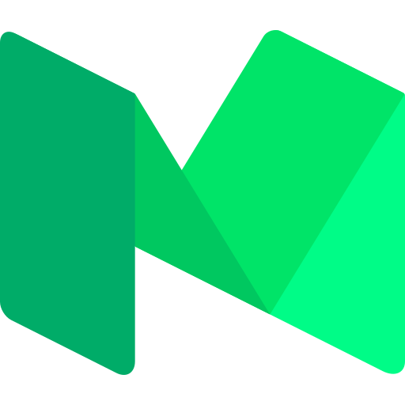

<!-- header -->

<p align="center">
  
</p>
<!-- Contacts -->
<p align="center">
  <a href="https://www.linkedin.com/in/lucas-dos-reis-lrs/">
    
  </a>

  <a href="mailto:lucaspook12@gmail.com">
    
  </a>

  <a href="https://medium.com/@lucasreissi">
    
  </a>

  <a href="https://www.instagram.com/lucas_reissi/">
    
  </a>
</p>

<p align="center">
  <a href="https://lucasreis.pages.dev">
    
  </a>
</p>

```
name: Lucas Reis
role: Computer Engineer, AI and Machine Learning
located_in: Recife, Pernambuco, Brazil
current_position: Master's student in Computer Science at UFPE
portfolio: https://lucasreis.pages.dev

education:
  [
    "Master's in Computer Science, UFPE (in progress since Aug 2025): quantum computing, meta-learning and model selection",
    "Bachelor's in Computer Engineering, UFPE (graduated May 2025)",
  ]

experience:
  [
    "AI Engineer, Tractian (Jun 2025 to Oct 2026): LLM-based agents and web-scraping data pipelines, from proof of concept to production",
    "Data Science Intern, Sebrae (Nov 2024 to Apr 2025): data analysis, machine learning models, API integration and ETL pipelines",
    "Research Intern in Quantum Neural Networks, PIBIC-CNPq (Sep 2022 to Oct 2023)",
    "Researcher in 5G Networks, Motorola/CIN-UFPE (Jul 2020 to May 2021)",
    "Vice-President, Quantum Computing Academic League, LACIQ-UFPE (Jul 2023 to Nov 2024)",
  ]

fields_of_interests:
  [
    "LLMs and AI Agents",
    "Data Engineering",
    "MLOps",
    "Machine Learning",
    "Quantum Computing",
    "Meta-Learning and Model Selection",
    "Software Development",
  ]

recent_projects:
  [
    "Industrial Product Scraper: turns messy product pages into clean, structured data",
    "Breakfast Forecast: price forecasting for breakfast foods with machine learning, scraping and APIs",
    "Quantum Dice: random results from a simulated quantum circuit, built as an educational project",
    "Evolvium: a Python library for optimization with genetic algorithms",
  ]

hobbies: ["Sports", "Programming", "Music", "Animals"]
```

<!-- tech stack -->

<h3 align="center">🚀 My Tech Stack</h3>

<p align="center">
  
  
  
  
  
  
  
  
  
  
  
  
  
  
  
  
  
  
  
  
  
  
  
</p>

<p align="center">
  
  
</p>

<picture>
  <source media="(prefers-color-scheme: dark)" srcset="https://raw.githubusercontent.com/lrs50/lrs50/output/github-contribution-grid-snake-dark.svg">
  <source media="(prefers-color-scheme: light)" srcset="https://raw.githubusercontent.com/lrs50/lrs50/output/github-contribution-grid-snake.svg">
  
</picture>
